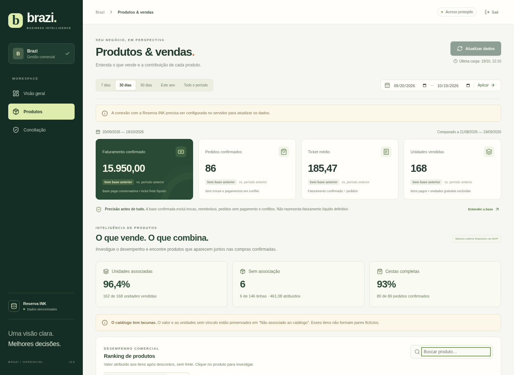
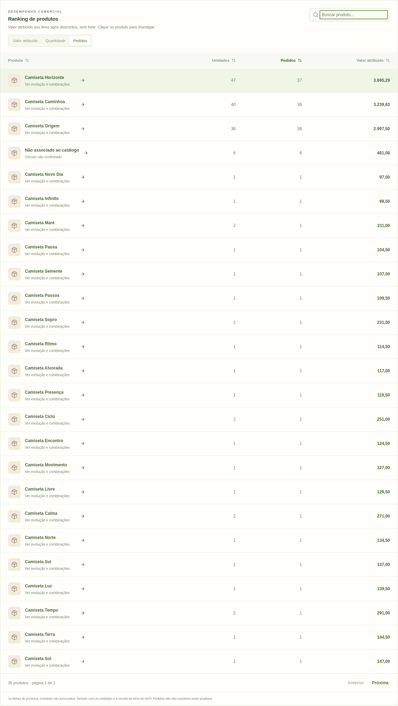
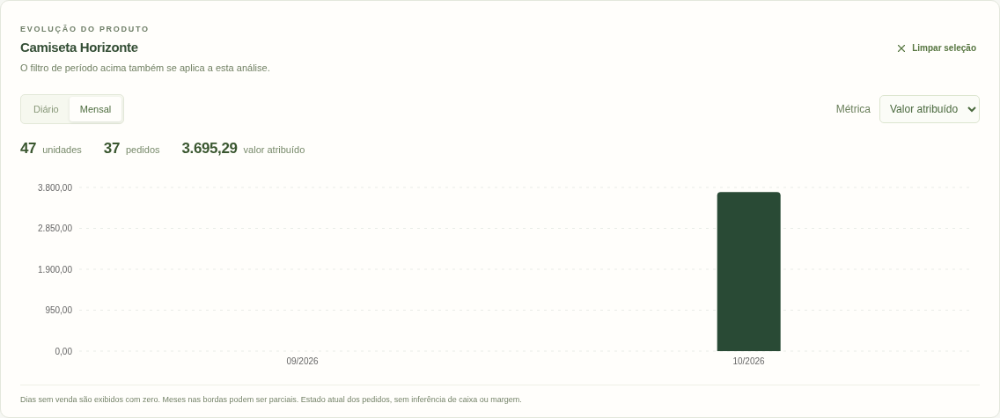
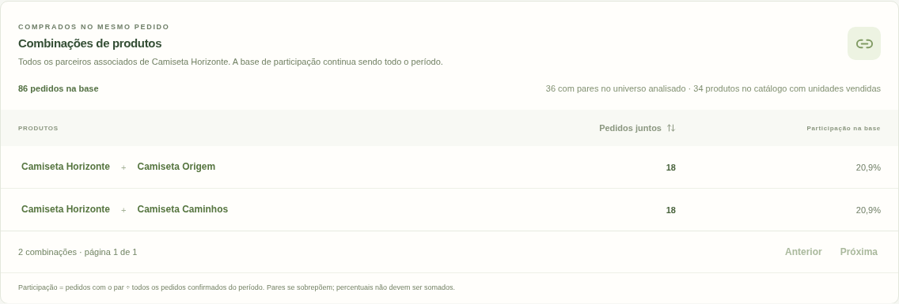
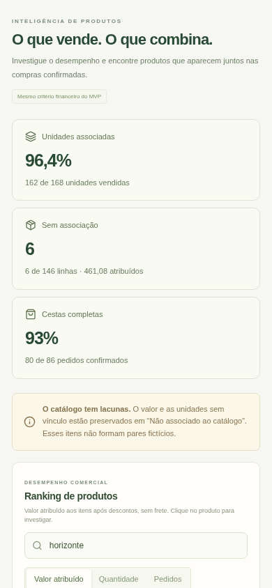
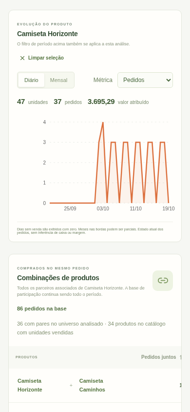

# Fase 2 / E1 — Inteligência de Produtos

**Data:** 19/10/2026 (America/Sao_Paulo).
**Branch exclusiva:** `develop/phase-2`. Base de desenvolvimento: `88943b2`.
**Situação:** implementação concluída, validada em ambiente isolado e disponível para revisão. Sem merge, deploy ou alterações no banco de produção. E2 não iniciada.

## 1. O que foi entregue

O módulo **Produtos**, dentro da navegação existente, agora permite:

- Ranking por **unidades vendidas, pedidos distintos e valor atribuído**; busca por nome sem distinção de acentos, ordenação crescente/decrescente e paginação.
- Investigar um produto, inclusive o grupo não associado, com **evolução diária ou mensal** por unidades, pedidos ou valor atribuído. Dias/meses sem registros aparecem com zero; períodos das bordas podem ser parciais.
- Ranking de **pares de produtos diferentes no mesmo pedido**, com quantidade de pedidos e participação na base confirmada. Repetições de linhas/unidades não multiplicam o par.
- Selecionar um produto para ver **todos os seus parceiros associados** no período, sem limitar essa investigação aos candidatos do ranking geral.
- Conferir cobertura de unidades, linhas, valor atribuído e cestas, com detalhamento de cestas completas, parciais, sem produto associado e sem unidades vendidas.
- Usar filtros de período já existentes, busca e estados de carregamento, erro com nova tentativa e ausência de resultados. A troca de consulta remove dados antigos da área em carregamento.

A identidade visual, sidebar, filtros globais e indicadores do MVP foram preservados. A interface oferece tabelas com cabeçalhos ordenáveis, indicação acessível de ordenação, controles rotulados, foco visível, paginação e rolagem horizontal de tabela no celular, sem transbordamento horizontal do documento.

Não foram implementados clientes, RFM/coortes, estampas, cores, modelagens, enriquecimento do catálogo, recomendações automáticas de preço/kits ou novas integrações INK.

## 2. Critério financeiro e definições

As classificações e a matemática de negócio continuam no backend:

- `classify()` permanece responsável pela elegibilidade, incluindo exclusões por troca, reembolso, pendência e conciliação; devoluções logísticas preservam o tratamento homologado.
- `allocate()` e `sum()` permanecem responsáveis por rateio exato e somas. O valor atribuído de cada linha é `item.total − parcela de promotion/paymentDiscount`, com o mesmo maior resto do MVP.
- A lógica de vínculo produto/variante/SKU e de atribuição foi extraída, sem mudança de comportamento, para [product-attribution.ts](../../src/domain/product-attribution.ts), reutilizada tanto pelo ranking antigo quanto pela E1. Conflitos e IDs desconhecidos permanecem não associados.
- Quantidade vendida é `quantity − free`; não se subtrai `refunded` novamente para reconhecer receita que o MVP já exclui.
- A soma de valores de produtos, incluindo desconhecidos, fecha com **receita de itens após descontos e sem frete**, não diretamente com faturamento que inclui frete líquido.
- Pedidos por produto são distintos dentro de cada produto. Somá-los entre produtos gera duplicidade; um mesmo pedido pode conter vários produtos.
- Não há cálculo de faturamento líquido definitivo, margem ou nova interpretação de moeda. A moeda continua vindo da configuração existente; sem configuração, aparecem unidades da API.

### Cestas e participação

Uma cesta contém o conjunto de produtos associados com pelo menos uma unidade vendida (`quantity−free>0`) em cada pedido confirmado. Itens gratuitos puros não criam presença; itens não associados não formam um produto fictício nas combinações. O ranking financeiro preserva as linhas conforme a regra do MVP, mesmo quando a presença na cesta não existe.

Para produtos A e B distintos:

`pedidos_juntos(A,B) = número de pedidos confirmados contendo A e B`.

`participação(A,B) = pedidos_juntos(A,B) / todos_os_pedidos_confirmados_do_período × 100`.

O denominador inclui pedidos sem associação ou sem pares. Selecionar um produto ou buscar no ranking não muda essa base. Os pares se sobrepõem: suas participações não devem ser somadas. Pedido com A+A+B conta uma vez para A+B; pedido com A+B+C contribui para três pares distintos. Não são inferidas causalidade, afinidade estatística ou aumento futuro de vendas.

### Cobertura

- Unidades associadas: `unidades associadas / unidades vendidas totais`.
- Linhas associadas: `linhas associadas / linhas de itens dos pedidos confirmados`.
- Valor associado: `valor atribuído associado / valor atribuído total`.
- Cestas completas: pedidos com ao menos uma unidade vendida e todas essas compras associadas, divididos por todos os pedidos confirmados.
- Denominador zero é informado como **Sem base**/null, sem percentuais fictícios.
- “Não associado ao catálogo” permanece no ranking e em sua evolução. Não é uma identidade válida para pares.

## 3. Endpoints locais e arquitetura

Todos os endpoints novos passam pelo hook de autenticação já existente. Em produção, acesso sem sessão recebe 401; logout revoga também o acesso à E1. As respostas têm Cache-Control no-store. Nenhum endpoint entrega dados pessoais de compradores.

| Endpoint GET | Filtros | Resposta principal |
| --- | --- | --- |
| `/api/intelligence/products` | `start`, `end`; `search` até 120 caracteres; `sort=value/quantity/orders/name`; `direction=asc/desc`; `page`, `pageSize` | Ranking paginado, cobertura, período, versão da carga, última sincronização, fuso/moeda e resumo do universo de pares |
| `/api/intelligence/products/:key` | `start`, `end`; `granularity=day/month`; key numérica positiva segura ou `unmapped` | Produto e série temporal; 404 quando não há presença no período |
| `/api/intelligence/baskets` | `start`, `end`; `productKey` opcional; `direction=asc/desc`; `page`, `pageSize` | Pares paginados, contagens, participação e metadados da análise |

Filtros desconhecidos, intervalo inválido ou excessivo, ordenação não permitida, busca longa e paginação inválida recebem 400. Períodos usam a mesma validação do MVP, inclusive limite de 3.660 dias. `pageSize` máximo 50; padrão 25, e interface de pares usa 10. Páginas além do fim são ajustadas para a última página válida.

A API **não consulta a INK ao abrir uma visualização**. Lê somente o PostgreSQL existente, com snapshot REPEATABLE READ do repositório atual. Não houve mudança de schema, migração nova, escopo de token ou rotina de sincronização.

O cache analítico guarda até **quatro combinações de versão/período**, por processo. Produtos, séries esparsas e cestas compactas de chaves são compartilhados entre ranking, evolução e pares. Cestas internas não incluem IDs de pedido/comprador e não são enviadas ao frontend. Nova versão de sincronização invalida a chave; suspensão/restart apenas esvazia o cache.

Solicitações simultâneas do mesmo período/versão compartilham a carga. Há no máximo duas preparações de períodos diferentes simultâneas; excesso recebe 503 e Retry-After de 3 segundos. O pool PostgreSQL e seus limites existentes foram mantidos. Nenhum serviço adicional ou armazenamento persistente no Render foi introduzido.

### Limite explícito do ranking geral de combinações

Para limitar custo quadrático e memória, o ranking geral analisa pares entre os **100 produtos com mais unidades vendidas** no período (desempate por pedidos e chave). Isso limita a 4.950 pares distintos. Todos os pedidos elegíveis continuam no denominador; não há amostragem de pedidos.

Se houver outros produtos, a interface informa quantos ficaram fora e a cobertura das **ocorrências de pares entre produtos associados**:

`ocorrências cobertas = Σ combinações(k_candidatos_da_cesta,2) / Σ combinações(k_associados_da_cesta,2)`.

Essa medida não inclui pares hipotéticos com itens desconhecidos; cobertura de catálogo aparece separadamente. Um par fora dos candidatos pode ser frequente e não aparecer no ranking geral, que não deve ser interpretado como um censo de todos os pares. Ao **selecionar um produto**, seus parceiros são contados com uma passagem nas cestas completas do cache, sem o limite de 100 e sem novas chamadas à INK. O payload continua paginado e o denominador permanece o mesmo. A API identifica os escopos `period` e `product`.

## 4. Evidências de testes

Os ensaios usaram somente PostgreSQL 17 local e dados sintéticos. `TEST_DATABASE_URL` é validada para host loopback e nome de banco terminado em `_test`; cada caso usa schema isolado. E2E desabilita o token INK. Não foi acessado o Supabase de produção nem a API comercial.

| Verificação | Resultado |
| --- | --- |
| `npm test` | **69 testes passaram**, nenhum ignorado, incluindo os testes do MVP e da E1 |
| `npm run build` | TypeScript backend/interface e build Vite passaram |
| `npm run test:e2e` | **8 testes Chromium passaram**, incluindo login real, consultas E1 reais ao backend/PostgreSQL e navegação responsiva |
| `npm audit --audit-level=high` | Nenhuma vulnerabilidade reportada na execução desta entrega |
| Conferência de escopo | Sem alterações em regras de classificação, valores monetários, normalização, autenticação do servidor, schema/migrações e contrato externo |

A referência congelada [e1-mvp-golden.json](../../test/fixtures/e1-mvp-golden.json) foi produzida **antes** da extração da atribuição. A saída inteira do dashboard com fixtures sintéticas — totais, comparação, ranking, status, conciliação e reembolsos — continua exatamente igual. Os testes preexistentes de vínculos ambíguos, arredondamento, gratuidade e reembolso também permanecem ativos.

Casos E1 cobertos:

- Fechamento de ranking, séries diária/mensal, unidades, valores e desconhecidos contra o MVP.
- Pedidos distintos, pares deduplicados, A+B+C, A repetido, item gratuito puro, ausência de vínculo, total vazio e denominador zero.
- Limite de candidatos com cobertura explícita e investigação de produto fora dos candidatos, retornando todos os parceiros.
- Busca sem acentos, ordenações, paginação, períodos inválidos e rota de detalhe inexistente.
- Snapshot PostgreSQL, cache entre endpoints, nova versão, limite de quatro períodos, coalescência e excesso concorrente com 503.
- Ausência de chamadas externas por visualização; erro de banco sem vazamento de mensagem/SQL/dados pessoais.
- 401 sem sessão, logout e proteção dos três endpoints; políticas de cookie e autenticação do MVP preservadas.
- Interface desktop/móvel, busca vazia, erro recuperável, mudança de período sem manter resultados antigos, gráfico diário/mensal e três métricas.

### Como reproduzir em ambiente de desenvolvimento/teste

Com Node 24, dependências instaladas, PostgreSQL de teste local e Chromium disponível, configure somente a variável de teste conforme o guia existente. Nunca use DATABASE_URL de produção para os ensaios.

```sh
npm ci
npm test
npm run build
npm run test:e2e
# Opcional: benchmark sintético; exige TEST_DATABASE_URL local.
node --expose-gc --import tsx scripts/benchmark-products.ts
```

Os testes de navegador usam `/usr/bin/chromium` ou CHROMIUM_PATH. O benchmark cria/remove schema local, compara os agregados com o MVP e não lê a base comercial. A captura é gerada por `e2e/products.spec.ts`; não há dados reais de compradores ou senhas nas imagens.

## 5. Desempenho e compatibilidade Free

| Pedidos sintéticos | Itens | Agregação p95 | Primeira HTTP | HTTP em cache p95 | Parceiros de um produto p95 | Pico RSS do processo |
| --- | --- | --- | --- | --- | --- | --- |
| 5.000 | 20.000 | 73 ms | 155 ms | 5 ms | 7 ms | 165 MiB |
| 20.000 | 80.000 | 244 ms | 377 ms | 10 ms | 14 ms | 266 MiB |
| 50.000 | 200.000 | 507 ms | 813 ms | 15 ms | 18 ms | 334 MiB |

[Resultados do ensaio](../evidence/e1/benchmark.json). Tempos locais são observações, não SLA no Render/Supabase. A primeira requisição é uma medição por cenário; agregação tem cinco amostras, cache HTTP dez e investigação de parceiros cinco. O pico RSS é do processo de benchmark acumulado, incluindo entradas, referência MVP e projeções; não é medição de um servidor Free em produção. O teste não simula todas as combinações de quatro caches, dois usuários frios e duas derivações de senha simultâneas.

Os resultados sustentam a arquitetura enxuta para volumes desta ordem, sem contratação adicional para E1. Não garantem desempenho com pedidos de cestas enormes, milhões de itens ou redes de maior latência. Se houver pressão de memória/tráfego, a evolução recomendada é projeção compacta ou pré-agregação versionada após medição, sem mudar a definição financeira.

Render Free e Supabase Free continuam sujeitos a suspensão, partida a frio e cotas. O benchmark não inclui cold start da plataforma nem latência remota. Não foram adicionados jobs, keep-alive ou novas garantias de disponibilidade. O Blueprint permanece Free, sem disco; o banco continua externo e inalterado.

## 6. Limitações conhecidas e aceite pendente

1. Vínculos usam os campos já persistidos e o catálogo atual; não há reconstrução de variantes/estampas históricas. Itens desconhecidos são preservados e explicitados.
2. O ranking geral de pares é limitado ao universo candidato informado. A investigação de um produto abrange todos os parceiros associados e não sana itens sem vínculo.
3. Valores refletem o estado atual dos pedidos, com datas de criação e regras homologadas; não são fluxo de caixa, receita líquida ou situação financeira em uma data passada. Zeros representam ausência de venda confirmada no snapshot/período selecionado, não previsão.
4. Ordenação de uma combinação é por pedidos conjuntos; sua participação tem o mesmo denominador e, portanto, a mesma ordem numérica. Não foram incluídos lift, causalidade ou recomendações automáticas de kits na E1.
5. Validação visual e funcional realizada no Chromium local; outros navegadores e a infraestrutura Free real precisam de homologação posterior autorizada.
6. As métricas de cobertura e o aviso de token ausente visíveis nas capturas pertencem à base fictícia local, sem token INK. Não descrevem a produção.

**Próximo passo:** revisão gerencial e homologação da E1 nesta branch. Não promover para `main`, não executar deploy e não iniciar E2 sem aprovação explícita.

## 7. Capturas — somente dados fictícios

### Visão desktop



### Ranking ordenável e paginado



### Investigação e evolução mensal



### Combinações e denominador explícito



### Experiência móvel




